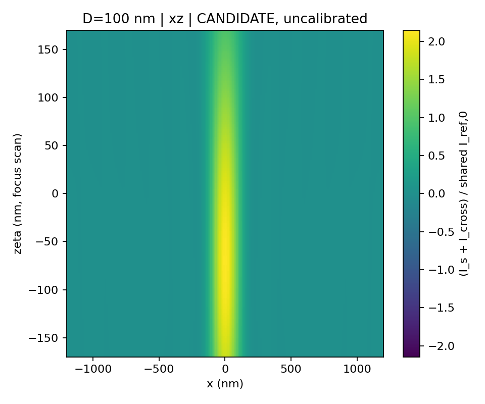
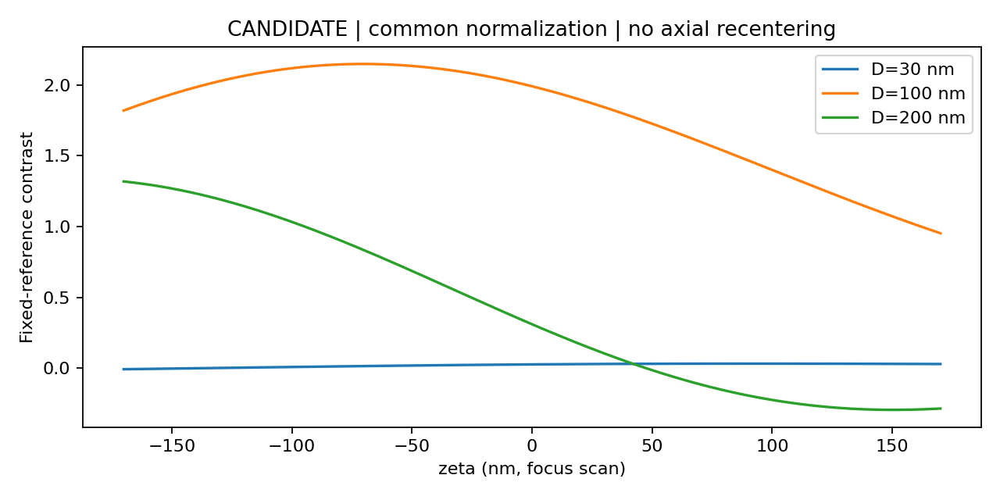

# Fe₃O₄ 表面附着单球 iSCAT through-focus 候选结果

> **结果类别：`CANDIDATE`。这是论文启发的候选实现，不是已经完成全部物理认证的严格复现。**
>
> 数据生成已完成，但完整 QWP/PBS/Fresnel/lens Jones 链、超临界高 NA 物理、相对复振幅和绝对标定仍未核实。横向 10→5 nm 双线性重建测试未达到 `1e-3` 门槛。

本仓库发布 532 nm、目标 NA=1.45、表面附着单球 Fe₃O₄ 的 through-focus 计算结果，粒径为 30、100、200 nm；球心高度分别为 15、50、100 nm。三组完整数据体的 shape 均为 `(171, 241, 241)`，对应 `zeta=-170:2:170 nm`、`x,y=-1200:10:1200 nm`。

## 完整数据下载

完整压缩包约 **1.19 GiB**，作为 **GitHub Release 资产**发布，不进入普通 Git 历史。由于 GitHub Release 单个资产只能单流上传，完整包被无损切分为 76 个 16 MiB 分片，以并行方式上传：

- Release 标签：`v1.0.0`
- 分片：`results_bundle.zip.part000` … `results_bundle.zip.part075`
- 重组后文件：`results_bundle.zip`
- 重组后大小：`1,273,486,344` bytes
- 重组后 SHA256：`fd5539a688e9b69bcf1f543518f08e1bbd8818e928f1f2c991ee24260857e1c7`
- 分片清单：`results_bundle.zip.manifest.json`（SHA256 `07b8d5a19ce260b4f7e57898e16b7a978c82b94cdf384e628f682a08700188df`）
- 自动下载与校验脚本：[data/DOWNLOAD_RESULTS.md](data/DOWNLOAD_RESULTS.md)、[scripts/download_results.py](scripts/download_results.py)

推荐使用脚本下载、逐片校验并自动重组：

```powershell
python .\scripts\download_results.py --tag v1.0.0 --out .\download
```

仓库已于 2026-10-29 设为公开，脚本默认匿名下载，无需 GitHub token。只有脚本输出 `FINAL ARCHIVE VERIFICATION PASSED` 才表示完整包下载成功。手工重组与校验步骤见 [data/DOWNLOAD_RESULTS.md](data/DOWNLOAD_RESULTS.md)。

## 实际主数据

| 粒径 | ZIP 内路径 | shape | 实际层数 | 文件字节 | SHA256 |
|---:|---|---|---:|---:|---|
| 30 nm | `release/D030nm/cube.h5` | `(171,241,241)` | 171 | 424,882,738 | `ecbbea68c663246f1404acc7dc588164f1f89d6f7d9e6ac082a359d35473ad46` |
| 100 nm | `release/D100nm/cube.h5` | `(171,241,241)` | 171 | 424,639,674 | `ffca89836461eae774e3d7917fc02f5aa64c5bd507d33979170abb1b4d919c49` |
| 200 nm | `release/D200nm/cube.h5` | `(171,241,241)` | 171 | 424,913,287 | `c94e7be2d5550fbe3173d4f5eacdc611e95c1edcf28e5814943f9e54b86de9d2` |

数组轴顺序为 `(zeta, y, x)`；复场最后维为 `(Ex, Ey)`。保存的是 through-focus **成像响应**，不是样品空间近场电磁场。

## 验收状态

- `data_generation = COMPLETE`
- `numerical_validation = PARTIAL`
- `source_version_audit = VERIFIED`（仅限用户指定的 Figshare v3 文件及作者预印本定位）
- `formula_fidelity = UNVERIFIED`
- `high_na_model_validation = UNVERIFIED`
- `absolute_calibration = false`
- `result_class = CANDIDATE`
- `github_release_assets = PASS`（83 个正式资产；76 个分片的服务端 size/digest 全部匹配）
- `github_e2e_download = PASS`（全部 76 个分片下载、逐片校验并重组；最终 ZIP SHA256 匹配）

现行测试 **31/31 PASS**，legacy 测试 **7/7 PASS**。压缩包生成后独立复核 **20/20 PASS**。这些通过项不能覆盖下列保留项：

1. 完整 Jones 链仍未由独立的 QWP/PBS/Fresnel/lens 矩阵闭合。
2. NA=1.45 超过水介质 `n_s=1.33`；超临界扇区采用解析延拓，数值收敛不等于有限球—界面 Maxwell 物理认证。
3. `gamma=0.5+0i` 是演示约定，不是 Fe₃O₄ 样品的实测相对复振幅；无绝对标定。
4. 横向 10→5 nm 双线性中点重建仍失败：相对 L2 为 `1.955e-3`、`1.543e-3`、`2.159e-3`（30/100/200 nm）。三次重建约 `4.7e-6–1.26e-5` 通过，但不能撤销双线性失败。
5. XDMF 结构已审计，但未用 ParaView 实际打开验证。

详见 [RESULTS.md](RESULTS.md)、[release/review.md](release/review.md)、[release/status.json](release/status.json) 和 [verification/post_package_verification.json](verification/post_package_verification.json)。

## 仓库内容

- `release/code/`：源码、测试、配置、实现补丁与审计文档
- `release/figures/`：截面、层图和轴向比较图（均为 `CANDIDATE`）
- `release/diagnostics/`：长程诊断、来源获取、HDF5/XDMF/图片审计
- `release/D030_focus_stack.xdmf` 等：三维查看文件；需与 Release ZIP 中的 HDF5 放在同一目录结构下
- `release/tests.json`、`release/convergence.json`、`release/config_used.json`、`release/environment.txt`
- `release/SHA256SUMS.txt`：完整 release 清单（含三个 `cube.h5`）
- `verification/`：压缩包生成后的独立复核记录
- `checksums/`：完整 ZIP 的 SHA256

三个 `cube.h5` 每个约 405 MB，超过 GitHub 普通 Git 的 100 MB 单文件限制，因此**没有**被提交到本仓库的 Git 历史。包含它们和对应 XDMF 的完整包位于 Release。

## 图像





## 固定任务边界

- 波长：532 nm
- 目标并实际积分到：NA=1.45
- 样品介质：水，`n_s=1.33`
- 单球、表面附着；球心高度 `D/2`
- 未引入 520 nm、400 Hz、布朗运动、相机模型或悬浮高度扫描
- 主网格直接计算，不是 pilot 插值放大

## 论文与附件

- 论文 DOI：<https://doi.org/10.1364/OE.480337>
- 指定 Figshare 文件：file id `52761698`，article `22047950`，version 3
- 下载与页级核对记录见 [release/source_audit.md](release/source_audit.md)
- 出版社最终排版 PDF 未取得；不声称已完成全版本来源认证

## 使用限制

本仓库数据可用于方法审查、数值复验和后续候选模型比较。不得把 `result_class=CANDIDATE` 写成“严格论文复现”或“全部物理认证完成”，也不得把无绝对标定的 `I_total`/contrast 直接当作实验相机图像或样品空间近场。
